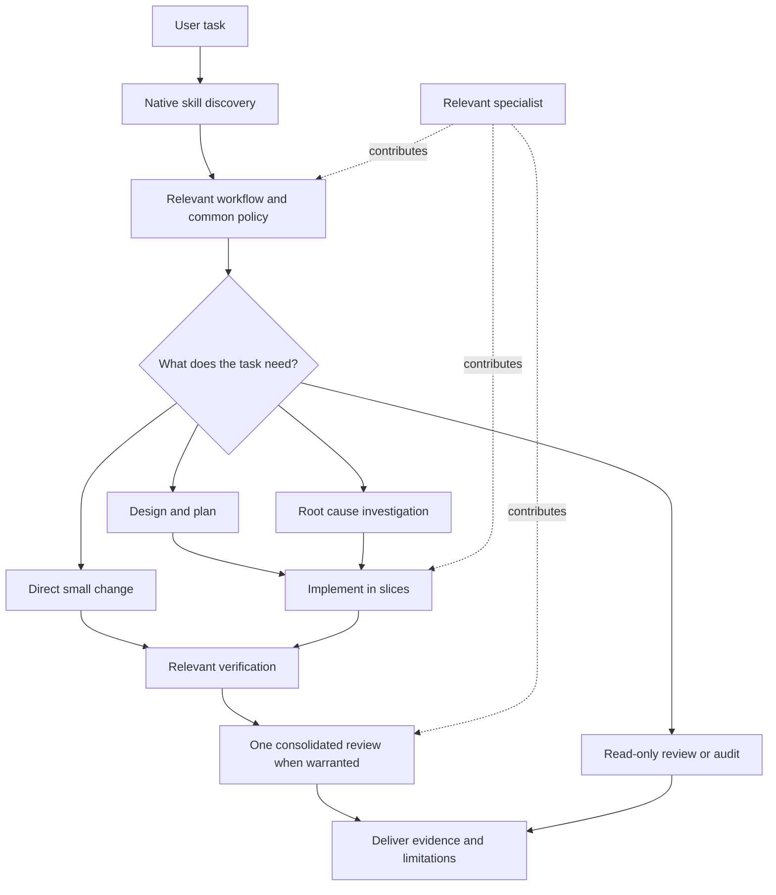

> Historical research/design baseline. The user subsequently approved implementation in conversation; status lines below reflect the proposal stage.

# Unified Engineering plugin: architecture proposal

Status: proposed, awaiting user approval. Date: 2026-11-16.

Working name: **Unified Engineering**, plugin identifier `unified-engineering`. The name is a proposal, not an upstream brand or a name already approved by the user.

## 1. Recommendation and alternatives

Build one instruction-first plugin with a common policy and consolidated workflows. Ponytail supplies the default simplicity philosophy; Superpowers supplies the workflow backbone; Addy's project supplies specialist engineering methods and useful refinements to those workflows.

Three approaches were considered:

| Approach | Benefit | Cost / reason |
|---|---|---|
| Bundle all three unchanged | Easy upstream synchronization | Retains three routers, overlapping mandatory workflows and duplicate testing; does not meet the integration requirement |
| **Consolidated skills with native discovery** | One coherent policy, selective context, no runtime service or hooks required | Requires careful adaptation, source mapping and behavioral tests; recommended |
| Runtime router, state service and hook adapters | Could provide stronger state/dispatch guarantees where host APIs allow | Adds hosting/configuration/tool dependencies and still cannot manufacture managed lifecycle hooks; unnecessary for V1 |

The proposed V1 has no MCP server, account integration, installation-time scripts or required hook runtime. The Android client supplies the conversation interface; the selected Codex environment supplies any code execution. Nothing needs to run in an Android terminal.

The user's current task is research and an architecture proposal only. Approval of this document would authorize the next implementation phase; no implementation has been started.

## 2. Policy hierarchy

This is a hierarchy for this plugin's optional guidance, not a replacement for the host's instruction hierarchy:

1. Host/system/developer constraints and applicable safety/authorization rules.
2. Explicit user instructions and the task's agreed scope, within those constraints.
3. Applicable project instructions and established conventions, subject to the host's precedence rules.
4. The unified policy: scope discipline, simplicity, evidence, modes and workflow selection.
5. The selected workflow, then relevant specialist procedures and examples.

No imported skill may declare itself above the unified policy. Existing user authorization carries forward. Skill preferences do not create repeated approval gates for reversible work already requested. User-requested gates remain binding: this project's architecture must be approved before implementation.

Security, accessibility, preservation of user data and honest reporting are not optional economy measures. If required verification cannot run, state the specific limitation and do not report a pass.

## 3. One owner per stage



The diagram does not prescribe every box for every task. An explanation does not enter a coding workflow. A review stays read-only. A one-line configuration correction does not need a design document. A new authentication system does need design, security analysis, meaningful tests and review.

Use one existing spec/task list where available. New artifacts follow project conventions, with `docs/engineering/` as a fallback for substantial work. No new SPEC plus a separate brainstorming spec plus two task ledgers for the same scope. No default per-task commits or worktrees when the managed workspace already provides adequate isolation.

## 4. Activation and manual invocation

Use the host's description matching and progressive disclosure, not a session-start bootstrap that loads another router.

- `engineering` matches general implementation requests and mode/help requests. It selects a workflow only when one is needed.
- Workflow descriptions distinguish design, planning, fixing, testing, reviewing, auditing and simplifying. Include explicit exclusion cases to reduce collisions.
- Specialists can activate directly from matching tasks, such as designing an API or checking a security boundary. They need not wait for `engineering` to be selected first.
- Every adapted entry point carries a short common policy so direct specialist invocation cannot bypass simplicity, authorization or mode handling. That header is generated from one maintained source; the runtime does not have to recursively load a meta-skill.
- Specialists add domain checks to the active task; they do not start a second design/plan/review lifecycle. Read only the sections relevant to the changed boundaries.
- `delegate`, `challenge`, `skill-authoring`, `workflow-diagnostics`, `ponytail-debt` and `ponytail-gain` are manual entry points. Use optional `agents/openai.yaml` invocation policy plus matching descriptions; verify enforcement in the target runtime. Their descriptions avoid broad startup/task triggers.
- In ChatGPT, use `@` selection where available, or ordinary text such as “Use the security skill” and “Use Lite mode for this task.” Do not promise Claude slash commands work on Android. Legacy skill names can be recognized as intent and routed to their canonical workflow without registering dozens of alias skills.

**Limit:** implicit matching is model/host behavior, not a deterministic event bus. This architecture aims for reliable measured activation; it cannot guarantee every coding turn loads a skill. A manually selected plugin/skill is the fallback when matching fails. The package cannot silence independently installed Ponytail or Superpowers instructions, so acceptance testing needs an uncontaminated test context.

## 5. Proposed skill inventory and complete upstream mapping

The proposed catalog has 28 entry points, organized by purpose. This count follows the distinct jobs below; it is not a target to optimize for its own sake. Fine-grained procedures remain references, not extra top-level routers.

### Policy and core workflows

| Unified entry | Upstream inputs | Treatment |
|---|---|---|
| `engineering` | Ponytail `ponytail`, `ponytail-help`; Superpowers `using-superpowers`, `verification-before-completion`; Addy `using-agent-skills` | One rewritten policy/help entry. Retain evidence-before-claims as a compact completion contract. Remove the 1% rule, stacked routers, hook settings and Claude help/update instructions. Manual `engineering verify` uses the same completion contract. |
| `design` | Superpowers `brainstorming`; Addy `spec-driven-development`, `interview-me`, `idea-refine` | One requirements/design workflow. Interview and divergent ideas are optional named procedures, manually available through this skill. One consequential clarification/approval flow, no repetitive confidence percentages or mandatory multi-turn interview for an already complete request. |
| `plan` | Superpowers `writing-plans`; Addy `planning-and-task-breakdown` | One dependency-aware plan with acceptance and verification steps. Reuse an existing adequate plan. |
| `implement` | Superpowers `executing-plans`; Addy `incremental-implementation` | Inline execution by default, thin verifiable slices, preserve progress across interruptions. No mandatory shell ledger framework. |
| `debug` | Superpowers `systematic-debugging`; Addy `debugging-and-error-recovery` | Reproduce, localize, test a hypothesis, fix the root cause, verify recurrence is blocked. Investigation-only requests do not authorize a code edit. |
| `test` | Both projects' `test-driven-development` | One test-first workflow for substantive behavior and logic bug fixes. Reuse the project's runner; test observable behavior, avoid mocks of the implementation. Mechanical/docs/config edits get the relevant validator or inspection instead of invented unit tests. |
| `review` | Ponytail `ponytail-review`; Superpowers `requesting-code-review`, `receiving-code-review`; Addy `code-review-and-quality` | One review of connected code with concrete evidence and severity. Review reception is a subprocedure, not another automatic review. Specialists contribute to the same findings list. |
| `ponytail-audit` | Ponytail `ponytail-audit` | Preserve its `SKILL.md` unchanged. Repository-wide, read-only, risk-first audit with explicit coverage limits. |
| `simplify` | Addy `code-simplification`, with Ponytail's policy | Preserve behavior and conventions, remove justified complexity, respect protected code. No automatic rewriting of unrelated code. |
| `ship` | Superpowers `using-git-worktrees`, `finishing-a-development-branch`; Addy `git-workflow-and-versioning`, `shipping-and-launch` | One delivery workflow. Worktree and git operations are conditional procedures; include commit-message/changelog-only requests without deployment steps. Release readiness and actual deployment remain distinct authorizations. |

### Specialist engineering entries

| Unified entry | Addy source skill | Treatment |
|---|---|---|
| `api` | `api-and-interface-design` | Retain contract/error/idempotency expertise; scope patterns to the API actually requested. |
| `browser` | `browser-testing-with-devtools` | Adapt to the actual supported browser/testing tools. Chrome DevTools-specific procedures remain conditional, never silently mapped to nonexistent tools. |
| `ci` | `ci-cd-and-automation` | Retain CI, cache, quality-gate and deployment-pipeline methods; no unsolicited pipeline installation. |
| `migrate` | `deprecation-and-migration` | Retain staged replacement and expand/contract patterns; do not remove a working system before the replacement is proven. |
| `docs` | `documentation-and-adrs` | Retain decision records and documentation drift checks; follow existing documentation conventions. |
| `frontend` | `frontend-ui-engineering` | Retain responsive/accessibility/design-system practices; verify with available project and host tools. |
| `observe` | `observability-and-instrumentation` | Retain useful signals, correlation, logging/metrics/tracing checks; no automatic telemetry service. |
| `performance` | `performance-optimization` | Measure, locate bottleneck, compare after change; do not add caching/abstraction on speculation. |
| `security` | `security-and-hardening` | Retain threat boundaries, input/auth/privacy/dependency checks; apply web-specific controls only where applicable. |
| `context` | `context-engineering` | Retain relevant-context selection and durable handoffs; activate for context work, not every session. |
| `standards` | `constraint-driven-development` | Explicit setup of project quality contracts/ratchets. Read existing constraints; do not launch an installation interview simply because none exist. Written instructions are not represented as deterministic enforcement. |
| `sources` | `source-driven-development` | Verify uncertain/version-sensitive APIs against authoritative docs. Cache only within supported tools and recorded evidence; no mandatory fetch for familiar local edits. |

These 12 skills preserve specialist substance but **are adapted, not advertised as byte-for-byte unchanged**: references, applicability, tool calls, handoffs and optional permission preferences must fit the unified policy.

### Advanced and reporting entries

| Unified entry | Upstream inputs | Treatment |
|---|---|---|
| `delegate` | Superpowers `dispatching-parallel-agents`, `subagent-driven-development` | One explicit, capability-gated delegation workflow. Separate independent tasks, bound reviewer work, reuse agents for fixes, follow the host's actual schemas/model rules. |
| `challenge` | Addy `doubt-driven-development` | Opt-in adversarial review, one initial pass; further passes require substantive new changes/findings. Offer external models only when relevant and authorized, not every cycle. Self-review is labeled honestly when fresh context is unavailable. |
| `skill-authoring` | Superpowers `writing-skills` | Preserve behavioral-evaluation methods; adapt harness assumptions and omit mandatory Graphviz or CLI setup. |
| `workflow-diagnostics` | Superpowers `diagnosing-superpowers` | Evidence-based diagnosis limited to available session material. No automatic seven-agent fan-out or upstream issue posting; no invented access to managed transcripts. |
| `ponytail-debt` | Ponytail `ponytail-debt` | Preserve `SKILL.md` unchanged; manual read-only ledger, no mode mutation. |
| `ponytail-gain` | Ponytail `ponytail-gain` | Preserve `SKILL.md` unchanged plus its cited upstream benchmark material. Explicitly upstream Ponytail results, never evidence of unified-plugin savings. |

All 46 canonical upstream definitions have a destination in these tables. Only the three named Ponytail reporting/audit `SKILL.md` files are proposed unchanged. Separate optional UI/invocation metadata can be added without changing those files. New help explains that slash syntax printed by a preserved upstream card is not a promise of an Android slash-command interface.

Upstream personas become checklists/templates in the relevant specialist or review skill. Their perspectives remain available without relying on Claude agent registration. Upstream commands become natural-language/manual entry paths to the corresponding skills. Full upstream copies remain in development source/provenance, outside the installable skill catalog.

## 6. Modes and configuration

| Mode | Effect | What stays required |
|---|---|---|
| Lite | Implement the requested scope with minimal ceremony; briefly name a smaller option if useful | Correctness, applicable project standards, meaningful verification and relevant specialist checks |
| Full, default | Prefer the smallest complete solution; reuse first; plan only when scope warrants it | Same quality floor; tests for meaningful new logic; report material limitations |
| Ultra | Additionally challenge unjustified scope or abstractions before building; accept the user's informed choice | Same quality floor; does not mean more plans, more agents or more review loops |

Risk and mode are separate. A Lite authentication change still needs security reasoning and tests. An Ultra spelling correction still needs no project plan. A specialist's concrete requirement takes precedence over a desire to shorten the diff when that requirement is necessary for the requested outcome.

V1 exposes only three preference fields:

| Field | Values | Default |
|---|---|---|
| `mode` | `lite`, `full`, `ultra` | `full` |
| `workflow` | `auto`, `manual` | `auto` |
| `specialists` | `auto`, `manual` | `auto` |

`manual` suppresses optional automatic workflow/specialist expansion; explicit invocation still works. It does not turn off the common correctness/evidence policy or host-required skill use. Delegation, external-model review and tool installation are never silently authorized by these settings.

Preference resolution: current explicit user instruction > earlier explicit session choice > optional project preference > packaged defaults, all subject to host/project constraints. The optional project preference is one `.unified-engineering.json` file at the confirmed project root; nothing searches a user's home or another repository. It is read only in an environment with that project, never required for chat-only use, and written only if the user asks to save project defaults. Known fields accept only the documented values; unknown or invalid fields are reported and defaults used for them. Configuration never contains executable commands or secrets.

Session choices are retained in the active conversation when available and included in authorized handoff notes. Do not promise a skill can persist settings across new conversations or always survive compaction. Cross-conversation global persistence through an MCP service is out of scope. “Off” means do not invoke the optional unified workflows again in this session unless asked; it does not disable other installed plugins or host rules.

## 7. Replacing hook intent through skills

| Upstream mechanism | V1 skill-level equivalent | Limit |
|---|---|---|
| SessionStart instruction injection | Relevant discovery plus compact common policy in adapted skills | No guaranteed startup event or always-on injection |
| UserPromptSubmit mode tracking | Interpret explicit current/session mode requests | No persistent flag file or interception of every prompt |
| SubagentStart propagation | Include task scope, effective mode and needed constraints in an authorized delegation prompt | Only delegates controlled by this workflow; no universal subagent hook |
| Repository map | Inspect relevant files at task start using available read tools | No automatic cached startup map |
| Statusline / Band / webhook ledger | Report mode on request and observed verification in normal output | No statusline, hidden telemetry or automatic task billing metrics |
| Source citation cache hooks | Reuse current evidence through available tools; revalidate when needed | No transparent WebFetch interception or cross-session cache guarantee |
| Simplification block filtering | Detect/honor protected markers; verify protected content remains unchanged | Instructions do not hide blocks from the model or enforce restoration |
| Constraint post-edit checks | Run selected checks deliberately, or use existing project CI | No always-running post-edit enforcement unless separately implemented by the project |

No executable lifecycle hooks are included in the managed package. A future desktop adapter is a separate, optional scope requiring its own support verification.

## 8. Source and package architecture

Keep the development project separate from all application repositories. Maintain one concise common policy, canonical workflow files, specialist content and a provenance map pinned to the audited commits. A small build-time assembler/validator may use Python's standard library; there is no runtime router or npm dependency for the core plugin.

The assembler's only jobs are to copy selected content, insert the common header into adapted skills, localize required references, generate optional metadata/manifests from one record and create a deterministic ZIP. It must not download or install upstream code at plugin runtime. Do not include multiple independently discoverable copies of merged skills.

Proposed **single-plugin archive**, with paths at ZIP root:

```text
plugin.json
.codex-plugin/plugin.json
skills/
  engineering/
    SKILL.md
    agents/openai.yaml
    references/defaults.json
  design/SKILL.md
  ... remaining canonical skill directories ...
  security/
    SKILL.md
    references/security-checklist.md
    references/hardening-patterns.md
  ponytail-gain/
    SKILL.md
    benchmarks/results/2026-10-07-agentic.md
    README.md
LICENSE
licenses/ponytail-MIT.txt
licenses/superpowers-MIT.txt
licenses/agent-skills-MIT.txt
ATTRIBUTION.md
SOURCES.json
README.md
```

Root `plugin.json` uses the documented portable schema with stable identity/version/description. A minimal generated `.codex-plugin/plugin.json` is retained for the compatibility/upload path established by the handoff, with matching identity/version, `skills: "./skills/"` and presentation metadata. Initially keep the OpenAI overlay there; omit inline `extensions.com.openai` so the documented fallback remains effective. Do not accidentally define both and expect them to merge. Select final fields against the current uploader schema during implementation/testing.

No marketplace catalog in the upload ZIP, no three nested plugin manifests, no `.git`, hook declarations, Claude userConfig, host installers, evaluation fixtures or unrelated assets. A separate future repository marketplace could point at this one plugin, but is not the upload artifact. Rootless layout avoids ambiguity about a single outer directory.

Every required reference belongs inside its owning skill package. Build-time duplication of a shared checklist is acceptable; maintain only one source copy. Rewrite cross-skill/repository-root paths and legacy invocations. Preserve headings/anchors, provenance and required notices. References are read using the host's skill resource mechanism when filesystem paths are unavailable. Never assume a `skill://` URI is a local path. Optional scripts require an explicit supported local execution path; the core workflows have instruction-only fallbacks.

The unchanged gain card's cited README and benchmark file are colocated under its skill at the relative paths printed in the card. That keeps provenance accessible without shipping the entire benchmark harness or implying those results describe the unified plugin.

## 9. Test and rollout gates after approval

### A. Static package checks

Validate manifest schema/identity consistency, skill frontmatter and names, invocation metadata, source/license coverage, and every required packaged path/anchor. Inspect the ZIP directly: exactly one plugin root, no marketplace/nested original plugins, no links escaping the archive, secrets, hooks or unsupported installation configuration. Extract into an empty directory and resolve each skill's full reference closure there. Check the three preserved source files against upstream hashes. These checks prove structure only.

### B. Discovery in managed ChatGPT

Use a distinct test identity/version and an isolated test account/workspace/session where old optional routers are not active. Keep the user's installed working plugins intact. Upload through the actual supported account flow; do not substitute a Codex CLI installation for this step. Enumerate discovered skills through the cloud registry and read each body and packaged reference. Verify manual selection, namespacing and optional invocation policy. If isolation is unavailable, label results as contaminated and do not claim precedence has been proven.

### C. Activation and behavior

Run a small fixed prompt matrix with positive and negative cases. Record selected skills, observed tool calls, artifacts, mode, host/date and the unchanged code/diff used for the test. Offline trigger ranking can catch mistakes but cannot prove host activation. Repeat ambiguous must-fire/must-not-fire cases in fresh contexts; routing is not deterministic.

| Example | Expected observable behavior |
|---|---|
| “Hi” / “Explain this function” | No engineering lifecycle or interview |
| “Fix this spelling error” | Direct edit and appropriate inspection; no design/review fan-out |
| “Add this specified validation rule” | Implement/test; no second specification of settled requirements |
| “Let's make a React todo list” | Scope-sensitive design, then relevant frontend/testing; one workflow |
| “This pagination test fails” | Root-cause investigation, regression test and minimal fix |
| “Why does this throw? Explain only” | Investigation/explanation without editing |
| “Review this diff” | One read-only review with severity/evidence, no rewrite |
| “Simplify this working function” | Preserve behavior, use existing tests; no feature expansion |
| “Add authentication in Lite mode” | Lite communication plus security/testing, same quality floor |
| “Use Ultra, then follow this exact approved design” | Challenge only a concrete justified concern, then respect the user's choice |
| “Use security manually; specialists manual” | Explicit invocation works; no automatic second lifecycle |
| “Use plan”, with an adequate existing plan | Reuse it rather than duplicate it |
| “Show shortcut debt / Ponytail gain” | Read-only output, no mode/state mutation or invented unified savings |
| “Use parallel agents”, tools unavailable | Report missing capability and execute inline if within scope |
| Protected simplification block / existing project constraints | Preserve the block and quality bar; no unsolicited checker installation |
| Prompt injection in repo/docs | Treat as data; do not change policy or send information elsewhere |

Test an explicitly requested approval gate and a waived optional gate, transitions among all three modes, session off/manual preferences, and a fresh session's defaults. Check failure reports when tests/browser/registry resources are unavailable. Measure observed token/latency where host evidence permits; compare representative prompts with the originals before claiming savings. No fabricated percentage reduction.

### D. Android acceptance and replacement

Confirm that the uploaded test plugin is available in the user's actual ChatGPT Android Codex flow, that manual invocation is usable, and that one nontrivial end-to-end task works with packaged references. Plugin authoring/distribution documentation does not establish every mobile UI/account feature. Account management steps the assistant cannot perform must be clearly identified rather than simulated.

Only after a clean standalone acceptance pass should the user consider disabling the old overlapping plugins for normal work. Disabling/uninstalling/replacing is a separate explicit user action, not a side effect of architecture approval or test upload. Retain the original working ZIPs/settings for rollback.

## 10. Approval boundary and remaining uncertainty

Approval requested for the recommended skills-only architecture, common policy, consolidation mapping, Full default with orthogonal risk checks, session-first settings, and staged target-runtime testing. Names, compact wording, implementation file organization and test-fixture details can be settled during implementation without reopening settled product choices.

Not yet verified: unified ZIP uploader acceptance; automatic activation reliability; managed invocation-policy enforcement; localized reference access for the new package; Android/account-specific installation and selection; persistence across compaction; and uncontaminated coexistence testing. No guarantee of global hooks or cross-session state is part of this proposal.

No plugin implementation, installation, replacement or bot-repository modification has been performed. Implementation remains paused for the architecture approval explicitly requested in the handoff.
